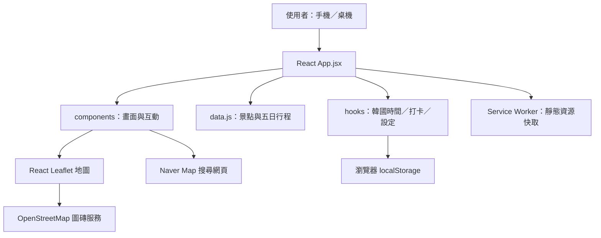

# 🧸 釜山一家三口旅行手帳｜Busan Family Trip V4

> **2026/11/13–11/17 · 五天四夜 · React 19 / Vite 7 / RWD / PWA**  
> 為爸爸、媽媽與一位 **5 歲、112 cm** 的小男孩設計的 Q 版旅行行程網站。整合每日時間軸、景點示意地圖、交通建議、韓文地址、行程提醒與親子工具箱。

---

## 目錄

1. [專案簡介](#1-專案簡介)
2. [功能總覽](#2-功能總覽)
3. [技術架構](#3-技術架構)
4. [專案目錄與模組職責](#4-專案目錄與模組職責)
5. [環境需求與本機啟動](#5-環境需求與本機啟動)
6. [網站使用教學](#6-網站使用教學)
7. [旅程資料及住宿資料維護](#7-旅程資料及住宿資料維護)
8. [手機 RWD 與 PWA](#8-手機-rwd-與-pwa)
9. [編譯及部署](#9-編譯及部署)
10. [資料儲存、隱私與限制](#10-資料儲存隱私與限制)
11. [常見問題與排查](#11-常見問題與排查)
12. [已知行程提醒與待辦](#12-已知行程提醒與待辦)

---

## 1. 專案簡介

本專案是 **純前端 Single Page Application（SPA）**，不需要後端 API 或資料庫，就能瀏覽旅行行程。它著重在「人在韓國當下，打開手機就能找到下一站、交通方式和韓文地址」，而不只是用來展示行程。

- **旅行日期**：2026/11/13（五）～2026/11/17（二）。
- **目的地**：韓國釜山，包含廣安里、海雲台、影島、東釜山、南浦洞與西面等區域。
- **旅行成員**：兩位大人與一位小男孩（預設 5 歲、112 cm，可修改）。
- **主視覺**：一家三口 Q 版插畫；桌機與手機各有專用圖片。
- **語言**：主要使用繁體中文，地址及景點名稱提供韓文。
- **時間**：今日旅遊模式使用 `Asia/Seoul`（韓國當地時間），不依賴裝置是否手動切換時區。

> **重要**：本網站不是實時路線規劃器、訂房系統或行程自動預訂服務。交通時間屬預估，路線、門票、營業時間及最後一天航班請在出發前確認。

## 2. 功能總覽

| 功能 | 使用情境 | 備註 |
| --- | --- | --- |
| Q 版首頁 | 開啟網站時顯示旅行主題 | 橫式／直式圖片依畫面尺寸呈現 |
| 五日切換 | 點 DAY 1～DAY 5 查看不同日期 | 所有行程資料來自 `src/data.js` |
| 今日旅遊模式 | 查看韓國時間、預計下一站及當天完成進度 | **依時間表和打卡推估**，不是 GPS 定位 |
| 時間軸 | 查看行程開始時間、說明、交通方式與預估移動時間 | 可依交通方式篩選 |
| 旅行打卡 | 將已完成的景點標記 ✓ | 僅存在使用者當前瀏覽器 |
| 行程小雷達 | 顯示時間重疊及預先設定的已知風險 | 屬**靜態檢查**，非即時營業資訊 |
| 景點地圖 | 查看該天景點的地圖圖釘 | OpenStreetMap 圖磚；圖釘與虛線不等於導航路線 |
| 交通攻略 | 點選某景點查看交通描述、預估耗時 | 人工預填建議，不保證即時班次 |
| Naver Map 入口 | 搜尋景點的韓文地址或韓文名稱 | 開啟**搜尋頁**，再由使用者選路線及起點 |
| 家庭工具箱 | 查看住宿、行李計畫、遊玩提醒及韓語小卡 | 住宿地址／年齡／身高可直接編輯 |
| 手機底部導覽 | 一鍵切換今天／行程／地圖／工具箱 | 小螢幕會以覆蓋式地圖呈現 |
| PWA | 將網頁加入手機主畫面 | 已快取頁面可部分離線使用，導航仍需連網 |

## 3. 技術架構

### 3.1 技術選型

| 類別 | 技術 | 用途 |
| --- | --- | --- |
| UI 框架 | **React 19** | 元件與互動狀態管理 |
| 建置工具 | **Vite 7**、`@vitejs/plugin-react` | 開發伺服器、HMR、正式打包 |
| 語言 | JavaScript + JSX | 目前**不是 TypeScript** 專案 |
| UI 動畫 | **Framer Motion 12** | 時間軸與景點細節切換動畫 |
| 地圖元件 | **React Leaflet 5 / Leaflet 1.9** | 圖釘、連線、縮放及地圖視圖 |
| 地圖底圖 | OpenStreetMap 公開圖磚 | 網路地圖畫面，需遵守服務使用政策 |
| 圖示 | **Lucide React** | 導覽及交通小圖示 |
| 樣式 | 原生 CSS + Media Queries | RWD、手機底部選單及安全區域 |
| 本機儲存 | Web Storage `localStorage` | 保存打卡與家庭設定 |
| PWA | Web App Manifest + 原生 Service Worker | 首頁安裝捷徑及有限的離線快取 |
| 後端／資料庫 | **無** | 目前為靜態前端網站 |

依 `package.json`，目前套件版本以 `^` 指定相容範圍；執行 `npm install` 會依當下可用版本解析。專案 ZIP 目前未附 `package-lock.json`，若需要可重現的部署，建議首次安裝並驗證後提交 lockfile。

### 3.2 系統結構



**資料流重點**：`App.jsx` 管理日期、選取景點與手機地圖開關；`data.js` 是主要靜態行程資料源；`useTripProgress` 與 `useLocalSettings` 將資料寫入瀏覽器本機。沒有帳號登入、多人同步或伺服器資料寫入。

### 3.3 重要互動流程

```text
選擇日期（DaySelector）
  -> App.jsx 更新 day
  -> Timeline 顯示該日時間軸
  -> TripMap 更新該日圖釘與示意線

點選時間軸景點
  -> App.jsx 更新 selected
  -> 手機上開啟地圖覆蓋層
  -> TripDetails 顯示交通、韓文地址與 Naver Map 搜尋

勾選完成（✓）
  -> useTripProgress 更新 done
  -> localStorage 保存打卡狀態
  -> TodayOverview 與總進度跟著更新

修改住宿／小孩資料
  -> FamilyToolkit 表單輸入
  -> useLocalSettings 更新 settings
  -> localStorage 自動保存於當前瀏覽器
```

## 4. 專案目錄與模組職責

```text
busan-cute-trip/
├── index.html                     # HTML 入口與 viewport / PWA metadata
├── package.json                   # 套件與 npm scripts
├── vite.config.js                 # Vite 設定：React 外掛、相對 base
├── README.md                      # 本說明文件
├── public/
│   ├── images/
│   │   ├── hero-desktop.png       # 桌機橫向一家三口首圖
│   │   └── hero-mobile.png        # 手機直式一家三口首圖
│   ├── icons/
│   │   ├── icon-192.png           # PWA 圖示
│   │   └── icon-512.png
│   ├── manifest.webmanifest       # 可安裝網頁的描述設定
│   └── sw.js                      # Service Worker 快取邏輯
└── src/
    ├── main.jsx                  # createRoot + CSS 匯入；production SW 註冊
    ├── App.jsx                   # 頁面組裝與主要狀態
    ├── data.js                   # places、days、modeMeta
    ├── style.css                 # 共用樣式、RWD、手機底部導覽
    ├── components/
    │   ├── Header.jsx            # 頂部品牌及返回第一天
    │   ├── Hero.jsx              # Q 版首頁及主視覺
    │   ├── DaySelector.jsx       # 五天選擇器
    │   ├── TodayOverview.jsx     # 今日時間／下一站／進度
    │   ├── Timeline.jsx          # 行程時間軸／交通篩選／打卡
    │   ├── ScheduleWarnings.jsx  # 靜態行程風險提示
    │   ├── TripMap.jsx           # Leaflet 地圖、圖釘與進度
    │   ├── TripDetails.jsx       # 景點、交通與韓文地址卡
    │   ├── FamilyToolkit.jsx     # 住宿、親子資格、行李、韓語小卡
    │   └── BottomNav.jsx         # 手機固定快捷列
    ├── hooks/
    │   ├── useKoreaTime.js       # 韓國當地日期／時間，每 30 秒更新
    │   ├── useTripProgress.js    # 打卡持久化
    │   └── useLocalSettings.js   # 家庭設定持久化
    └── utils/
        ├── schedule.js           # 行程時間解析／靜態警示
        └── travel.js             # Naver 搜尋網址／Leaflet 客製圖釘
```

### 如何挑選要修改的檔案？

| 需求 | 主要檔案 |
| --- | --- |
| 新增／刪除景點、修改時間與交通 | `src/data.js` |
| 修改景點韓文名稱、地址及地圖座標 | `src/data.js` → `places` |
| 新增提醒或調整警告文字 | `src/utils/schedule.js` |
| 修改今日下一站邏輯 | `src/components/TodayOverview.jsx` |
| 修改景點詳情、韓文複製及導航連結 | `src/components/TripDetails.jsx` |
| 修改小朋友預設身高年齡、住宿與行李預設資料 | `src/hooks/useLocalSettings.js` |
| 修改工具箱欄位 | `src/components/FamilyToolkit.jsx` |
| 修改地圖圖釘與軌跡 | `src/components/TripMap.jsx`、`src/utils/travel.js` |
| 修改 RWD、手機底部導覽視覺 | `src/style.css`、`src/components/BottomNav.jsx` |
| 更換一家三口圖片 | `public/images/`、`src/components/Hero.jsx` |
| 修改 PWA 名稱、圖示、快取策略 | `public/manifest.webmanifest`、`public/sw.js` |

## 5. 環境需求與本機啟動

### 5.1 前置環境

建議使用：

- Node.js **22.12+**（亦可使用相容的 Node.js 20.19+）。
- npm（隨 Node.js 安裝）。
- VS Code 或其他文字編輯器。
- Chrome / Edge / Safari 等現代瀏覽器。
- 首次安裝套件及載入地圖需要網路。

檢查版本：

```bash
node -v
npm -v
```

### 5.2 Windows / macOS / Linux 啟動

1. 解壓縮 ZIP，進入**含 `package.json`** 的 `busan-cute-trip` 資料夾。
2. 使用 VS Code 開啟該資料夾。
3. 在終端機依序執行：

```bash
npm install
npm run dev
```

4. 電腦瀏覽器打開終端機顯示的網址，通常為：

```text
http://localhost:5173
```

目前 `package.json` 定義的命令：

| 指令 | 說明 |
| --- | --- |
| `npm run dev` | 啟動 Vite 開發伺服器，監聽 `0.0.0.0` |
| `npm run build` | 輸出正式版到 `dist/` |
| `npm run preview` | 本機預覽 `dist/`，同樣監聽 `0.0.0.0` |

停止開發伺服器：回到終端機按 **Ctrl + C**。

### 5.3 手機連線測試

1. 電腦與手機連到**同一個 Wi-Fi／區域網路**。
2. 在電腦查詢區域網路 IP：
   - Windows：`ipconfig` → 找到目前網卡的 IPv4 Address。
   - Linux：`hostname -I`。
   - macOS：`ipconfig getifaddr en0`（實際介面可能不同）。
3. 在手機瀏覽器輸入：`http://<電腦內網IP>:5173`，例如 `http://192.168.1.20:5173`。
4. 如果無法連線，確認 Wi-Fi 是否相同、Windows 防火牆是否允許 Node.js / TCP 5173，以及是否有公司網路隔離或 VPN。

> 手機透過 `http://192.168...` 進入開發站時，因為不是 HTTPS／localhost，**PWA Service Worker 或剪貼簿功能可能被瀏覽器限制**。請將 PWA 安裝、完整離線與剪貼簿功能放到 HTTPS 站台測試。另：專案只在正式 build 才註冊 Service Worker，所以 `npm run dev` 不會完整展示 PWA 行為。

## 6. 網站使用教學

### 6.1 第一次進入網站

首頁顯示一家三口 Q 版主視覺，並提供 11/13～11/17 的五日切換。桌機主要是**左側行程＋右側地圖**；手機改成**單欄閱讀＋底部導航**。

### 6.2 查看每天行程

1. 點 **DAY 1～DAY 5** 選擇日期。
2. 向下查看時間軸，包括景點、活動說明、交通工具、預估交通時間。
3. 可使用「交通」下拉選單，只顯示地鐵、步行或計程車等行程。
4. 點某個景點的卡片，查看**交通攻略**與**景點筆記**；在手機上會同時打開地圖介面。
5. 看完按「收起地圖」返回行程，或按手機底部「行程」。

### 6.3 查看今日下一站

首頁 **「今天」** 區塊會顯示韓國時間與預計下一站。旅行期間會利用每日時刻表和打卡狀態推估待辦行程，並可跳至該景點；旅行前則為行程預覽。

**它不會讀取手機 GPS，也不會偵測您是否真的到達景點。** 如果提前、延誤或跳過行程，可用打卡記錄自行調整已完成項目。

### 6.4 景點交通與導航

1. 點選時間軸景點或地圖圖釘。
2. 在右側（或手機全螢幕地圖）的**交通攻略**中查看文字路線、交通工具、估計耗時。
3. 點 **「複製給司機／店家」** 複製韓文地址。
4. 點 **「在 Naver Map 搜尋景點」** 開啟 Naver Map，確認是否為正確景點，然後在地圖 App 內自行指定起點、交通方式和導航。

> **注意**：網站連的是 Naver Map 的**目的地搜尋**，目前未傳送完整起訖點的官方導航路線；地圖上連接景點的虛線只是示意，**不要依虛線實際步行或開車**。部分住宿和未指定餐廳的圖釘亦僅為區域示意。

### 6.5 旅行打卡

- 時間軸每一站右側有 **✓** 按鈕，點擊代表完成；再點一次可取消。
- 完成進度會反映在「今天」及地圖下方的進度資訊。
- 關閉後重新進入**同一瀏覽器、同一網站來源**通常可保留。
- 換手機、無痕模式、清除瀏覽器資料或更換網站網域，資料可能不見；目前沒有跨裝置同步。

### 6.6 家庭旅行工具箱

在手機點底部 **「工具箱」**，可管理：

- **住宿地址**：兩間住宿韓文地址已預填，可編輯、複製及開啟 Naver Map 搜尋。
- **返台行李計畫**：設定最後一天行李去向，避免跑回住宿拿行李。
- **機場目標抵達時間**：目前預設 `16:30`，屬個人規劃值，非航空公司保證的最晚到場時間。
- **兒童年齡／身高**：預設 `5 歲`、`112 cm`，顯示 Skyline Luge 的乘坐提醒。
- **韓文溝通小卡**：可複製「請帶我去這裡」「洗手間在哪裡」等韓文句子。
- **緊急資訊**：韓國警察 `112`、消防與救護 `119`。

修改這些欄位後會自動儲存於目前瀏覽器，不需要按「儲存」。請不要在此記錄護照號碼或其他敏感資訊。

## 7. 旅程資料及住宿資料維護

### 7.1 修改五日行程

編輯 `src/data.js` 的 `days` 陣列，每天有 `date`、`week`、`name`、`description` 及 `items`。

以下為**示意結構**，不是完整原始行程：

```js
{
  date: '11/15',
  week: '日',
  name: '海雲台親子日',
  items: [
    {
      time: '10:00–11:10',
      title: 'SEA LIFE 水族館',
      desc: '參觀海洋生物',
      place: 'sealife',
      mode: 'walk',
      duration: '約 5–10 分',
      transit: '從海雲台海灘步行前往。',
      note: '視實際入場及排隊情況調整。'
    }
  ]
}
```

常用 `items` 欄位：

| 欄位 | 作用 | 注意事項 |
| --- | --- | --- |
| `time` | 預定時段，例如 `10:00–11:10` | `utils/schedule.js` 會解析開頭與 `–`/`-` 後的結束時間 |
| `title` | 行程名稱 | 顯示於時間軸與詳情 |
| `desc` | 活動描述 | 簡短即可 |
| `place` | 景點 ID | 必須對應 `places` 的 key 才能在地圖標示 |
| `mode` | 交通方式 | 目前支援 `plane`、`metro`、`walk`、`taxi`、`bus` |
| `duration` | 交通時間的顯示文字 | **不會自動計算**，須自行更新 |
| `transit` | 詳細交通文字 | 可寫轉乘站、方向及提醒 |
| `note` | 額外警告或補充 | 選填 |
| `optional` | 可加碼的彈性行程 | 選填布林值，例如 `true` |

如新增景點，記得同時在 `places` 增加對應的 ID；修改行程文字**不會**讓交通時間或地圖座標自動更新。

### 7.2 修改景點資訊及地圖位置

`src/data.js` 的 `places` 例如：

```js
sealife: {
  name: 'SEA LIFE 釜山水族館',
  ko: '씨라이프 부산아쿠아리움',
  pos: [35.1603, 129.1603], // [緯度, 經度]
  type: '親子',
  emoji: '🐠',
  address: '부산광역시 해운대구 해운대해변로 266'
}
```

- `pos` 為 Leaflet 座標：**先緯度、後經度**。
- `address` 為韓文地址；未能確認精確地址的景點，勿將區域地址當作門牌。
- `mapApprox: true` 表示位置只是區域示意。
- `ko` 是在沒有指定地址時，Naver Map 用來搜尋的韓文名稱。
- 外部地圖搜尋結果可能有同名店家，請核對分店及地址。

### 7.3 修改住宿資料

目前已預填兩間住宿：

| 住宿 | 住宿日期 | 韓文地址 |
| --- | --- | --- |
| Hotel Central Bay Gwangalli | 11/13～11/14 | `부산광역시 수영구 광안해변로 189` |
| Daisy House | 11/14～11/17 | `부산광역시 수영구 민락본동로19번길 16-1, 101호` |

**旅途中修改（不需要改程式）**：工具箱 → 住宿地址輸入框 → 直接更改，內容自動存在本機。

**修改新使用者的預設值（需要改程式）**：開啟 `src/hooks/useLocalSettings.js`，找到 `defaults`：

```js
const defaults = {
  childHeight: '112',
  childAge: '5',
  centralBayAddress: '부산광역시 수영구 광안해변로 189',
  daisyAddress: '부산광역시 수영구 민락본동로19번길 16-1, 101호',
  bagPlan: '建議退房後帶行李到西面安排寄放；前往機場前務必取回。',
  airportTarget: '16:30'
};
```

**重要**：修改程式中的預設值，不一定會覆蓋使用者已存在瀏覽器的自訂值。此專案優先讀取 `localStorage` 中既有的有效欄位。如果測試時看不到新預設，可用無痕視窗或在瀏覽器 DevTools → Application → Local Storage 清除相關測試資料後重新進入（**會丟失當前自訂設定**）。

在 `src/data.js` 的 `places.centralbay` / `places.daisy` 也分別有住宿預設地址與示意座標。修改預設住宿時，建議同步檢查這兩處資料，以及每日交通文字。**Daisy House 位於民樂洞／廣安里，不在海雲台**；兩間住宿的門牌、房號仍應以訂房確認單為準。

### 7.4 更新提醒規則

`src/utils/schedule.js` 內有：

- `clockMinutes()`：解析時段起始時間。
- `endMinutes()`：解析時段結束時間。
- `KNOWN_CHECKS`：手動維護的特定日期警示（例如 ARTE MUSEUM 跨區、Club D Oasis、Skyline Luge、機場行李）。
- `validateDay(dayIndex)`：整合靜態提醒及相鄰行程時間重疊提示。

日期索引使用 **0～4**（Day 1 = `0`、Day 5 = `4`）。目前不會主動查詢各景點開放時間，也不會依實際導航時間判定是否來得及。

## 8. 手機 RWD 與 PWA

### 8.1 RWD 設計

- 桌機採**時間軸＋地圖雙欄布局**。
- 約 **900 px 以下**切換為單欄，地圖以可開關覆蓋層呈現。
- 手機底部固定四個入口：**今天 / 行程 / 地圖 / 工具箱**。
- 窄畫面將卡片、表單、下一站按鈕調整為較易單手操作的形式。
- CSS 使用 `env(safe-area-inset-bottom)`，支援具底部安全區的手機。
- 提供 `prefers-reduced-motion` 的降低動態效果設定。

### 8.2 將網站加入手機主畫面

**必要條件**：先將正式版部署到 **HTTPS** 網址；開發機 `localhost` 是例外安全環境，但手機連局域網 IP 的 HTTP 網址不應視為可完整安裝 PWA 的測試環境。

**iPhone（Safari）**：

1. Safari 開啟部署後的 HTTPS 網址。
2. 點分享按鈕。
3. 選擇「加入主畫面」（不同 iOS 版本選單位置可能不同）。
4. 確認名稱後新增，從主畫面圖示打開網站。

**Android（Chrome）**：

1. Chrome 開啟網站的 HTTPS 網址。
2. 點選瀏覽器選單。
3. 選擇「安裝應用程式」或「加到主畫面」（依裝置不同）。
4. 按提示完成。

### 8.3 離線功能的實際範圍

`public/sw.js` 目前採用**同源 GET 請求 network-first** 快取策略：先嘗試網路，失敗時回退至先前快取的資源。初次安裝會預先快取網站入口、manifest 與兩張首頁圖；正式 JS/CSS 等資源通常須在已成功載入後才會快取。

| 使用情境 | 離線行為 |
| --- | --- |
| 已載入過的首頁、程式及圖片 | **有機會**由快取顯示，依實際快取狀況 |
| 旅行打卡／住宿表單 | `localStorage` 本機資料可保留，前提是網站程式已可載入 |
| Leaflet 地圖圖磚 | **不保證**離線可用 |
| Naver Map 搜尋與實際導航 | **需要網路** |
| 即時天氣／交通班次 | 此版本**未串接即時服務** |

**建議**：出發前在每台手機都使用正式網址開啟並瀏覽各日內容，測試飛航模式下哪些頁面能使用。請另外下載重要訂房資訊、護照以外的必要聯絡資料與交通備份，不要將本網站當作唯一離線資料來源。

## 9. 編譯及部署

### 9.1 正式編譯與本機預覽

```bash
npm install
npm run build
npm run preview
```

完成後會產生：

```text
dist/
  index.html
  assets/...
  images/...
  icons/...
  manifest.webmanifest
  sw.js
```

`dist/` 是可上傳到靜態網站伺服器的內容。**不用**將 `src/` 或 `node_modules/` 上傳至靜態伺服器。

> 交付驗證狀態：目前是 README 與專案 ZIP 文件更新；原 V4 尚無已確認成功的 npm 正式編譯記錄。請在本機執行 `npm install && npm run build`，確認沒有版本或建置錯誤再正式發布。

### 9.2 部署到 Nginx（Ubuntu 範例）

先在可執行 Node.js 的環境編譯，再將 **`dist` 內容**複製至 `/var/www/busan-trip/`：

```bash
sudo mkdir -p /var/www/busan-trip
sudo cp -r dist/. /var/www/busan-trip/
```

以下為部署在獨立網域根目錄的概念範例：

```nginx
server {
    listen 80;
    server_name trip.example.com;

    root /var/www/busan-trip;
    index index.html;

    location / {
        try_files $uri $uri/ /index.html;
    }
}
```

儲存 Nginx 設定後：

```bash
sudo nginx -t
sudo systemctl reload nginx
```

**正式公開時必須配置 HTTPS 憑證**，PWA 功能才能正常使用。若與其他服務共用既有 Nginx reverse proxy，請將靜態網站安排在獨立網域或明確子路徑，避免覆蓋既有 `location /`。

### 9.3 部署到 IIS（Windows）

1. 先在開發機執行 `npm run build`。
2. 將 `dist/` 下所有檔案放入 IIS 網站或應用程式目錄。
3. 指定站台的靜態檔案服務與預設文件 `index.html`。
4. 如果未來有加入 React Router 的路徑頁面，需另外設定 URL Rewrite / fallback；**目前專案沒有前端路由套件**，大多數情境直接靜態部署即可。
5. 正式站台應使用 HTTPS，並確認 `manifest.webmanifest`、`sw.js` 能正常存取。

### 9.4 部署到 GitHub Pages

1. 建立 GitHub repository。
2. 執行 `npm run build`。
3. 用 GitHub Actions 或 Pages 的部署流程發布 `dist/` 內容。
4. 目前 `vite.config.js` 設為 `base: './'`，採**相對資源路徑**，對子資料夾式靜態部署較友善；仍應檢查實際 Pages URL、PWA `start_url` 和 Service Worker 範圍。
5. 部署完成後用手機實機測試首頁圖片、Leaflet、導航外連及 PWA 安裝。

### 9.5 更新網站版本後看不到新內容？

由於使用 Service Worker，瀏覽器可能保留舊快取。建議先重新整理，必要時在瀏覽器 DevTools → Application → Service Workers 檢查及移除舊快取後再測試。正式版更新時可考慮調整 `public/sw.js` 的 `CACHE` 版本（目前是 `busan-family-v3`），並重新部署。清除 Local Storage 可能連帶清除打卡與住宿自訂資料，請不要直接將兩種儲存空間混為一談。

## 10. 資料儲存、隱私與限制

### 10.1 localStorage Keys

| Key | 內容 | 檔案 |
| --- | --- | --- |
| `busan-complete-v1` | 各日各站是否打卡 | `src/hooks/useTripProgress.js` |
| `busan-2026-family-settings-v2` | 小孩身高年齡、兩間住宿、行李計畫、機場目標時間 | `src/hooks/useLocalSettings.js` |

資料只存在目前**瀏覽器與網站來源**，沒有任何雲端備份；同一使用者換手機／換瀏覽器不會自動同步。公開靜態網站並不等於公開這些本機資料，但不應儲存機密資訊，也應注意共享裝置的瀏覽器資料。

### 10.2 資料真實性與安全邊界

- 住宿：地址已預填，需與**訂房確認單**再次核對；圖釘可能為區域示意。
- 交通：規劃文字及耗時為估算；即時捷運班次、公車到站、車資及轉乘出口並未自動查詢。
- 景點：營業時間、門票、兒童身高限制及天候停業依官方與現場公告。
- 位置：本專案**不請求 GPS 定位**；`TodayOverview` 只是依計畫推估下一站。
- 地圖：使用 OpenStreetMap 底圖；行程 Polyline 是景點間直線，不是道路或大眾交通路徑。
- PWA：Service Worker 不能取代 Naver Map 的離線地圖服務。
- 住宿備註：請不要填入房門密碼、護照號碼等私密資料。

## 11. 常見問題與排查

### Q1. 執行 `npm run dev` 顯示 `vite` 找不到？

先確認位於有 `package.json` 的目錄，執行 `npm install`。如果套件未成功下載，確認 npm registry、公司 Proxy、VPN 或網路存取。

### Q2. `npm run build` 失敗？

確認 Node.js 版本（Vite 7 需要較新的 Node.js），再檢查 npm 套件錯誤及終端機訊息。目前 ZIP 未附 lockfile，首次解析相依版本可能隨時間改變。

### Q3. 手機打不開 `localhost:5173`？

`localhost` 在手機上指的是**手機自己**。請使用電腦的內網 IP，例如 `http://192.168.1.20:5173`，並確認相同 Wi-Fi 和防火牆設定。

### Q4. 手機地圖看不到或一片灰？

先確認可連線 OpenStreetMap 圖磚服務；確認網路、VPN／Proxy、地圖 DOM 尺寸及瀏覽器 Console 訊息。手機需要按底部「地圖」切到覆蓋式地圖；網路離線時不保證有圖磚。

### Q5. 點 Naver Map 沒有直接開始導航？

目前按鈕實作為 `https://map.naver.com/p/search/...` 的**搜尋連結**，不是具有指定起點、模式與路線的即時導航連結。請在 Naver Map 選正確目的地後再選導航。

### Q6. 我改了 `useLocalSettings.js`，首頁仍是舊地址／舊身高？

瀏覽器先讀取已存在的 localStorage 自訂值。你可以直接到「工具箱」修改；或只在測試環境清除 `busan-2026-family-settings-v2` 後重新載入。注意清除資料會失去既有設定。

### Q7. 手機無法複製韓文地址？

網頁透過 `navigator.clipboard.writeText()` 操作剪貼簿，通常需要 HTTPS、安全環境與使用者操作。先確認網站使用 HTTPS、Safari/Chrome 版本及剪貼簿權限。

### Q8. 地圖住宿圖釘與韓文地址不相符？

住宿圖釘目前是**廣安里附近示意位置**，不代表門牌精確定位。請使用工具箱預填韓文地址透過 Naver Map 搜尋，並對照訂房確認單。

### Q9. 為什麼手機和電腦打卡不一致？

因為沒有後端，資料存在每台裝置的 localStorage。若未來要同步，可另加登入與雲端資料服務，但不是目前版本功能。

## 12. 已知行程提醒與待辦

### 12.1 旅程特別注意

| 日期 | 重點 | 建議 |
| --- | --- | --- |
| **11/14 Day 2** | ARTE MUSEUM BUSAN 位於影島，跨區交通耗時 | 重新評估 10:00～11:30 的彈性展覽是否有足夠往返時間 |
| **11/15 Day 3** | Club D Oasis 各設施有不同開放時段 | 旅行前確認水樂園及各區營運；不要假設 20:00 前所有設施都開放 |
| **11/16 Day 4** | 小朋友 5 歲、112 cm | Skyline Luge 不可單獨駕駛；親子共乘須由符合資格成人陪同並以現場規定為準 |
| **11/17 Day 5** | Daisy House 在民樂洞，西面與機場是不同方向 | 確認退房後行李寄放位置，避免為取行李折返延誤機場報到 |

### 12.2 建議後續加強（**目前尚未實作**）

- 即時天氣與雨天替代行程 API。
- 即時交通／路線計算、可靠的起訖點深連結與預估車資。
- 各店家與景點即時營業時間、票價、預約及候位資訊。
- 行程重新排程演算法、旅費記帳與三人多裝置同步。
- 完整離線地圖及跨裝置行程資料匯入／匯出。
- 單元測試、E2E 測試、無障礙稽核及 CI/CD。

---

**備註**：本文件依 V4 專案實際原始碼與目前預填的五日行程撰寫。出發前務必核對兩間住宿、航班、營業時間及親子活動規定。祝一家三口釜山旅遊平安順利！🌊
